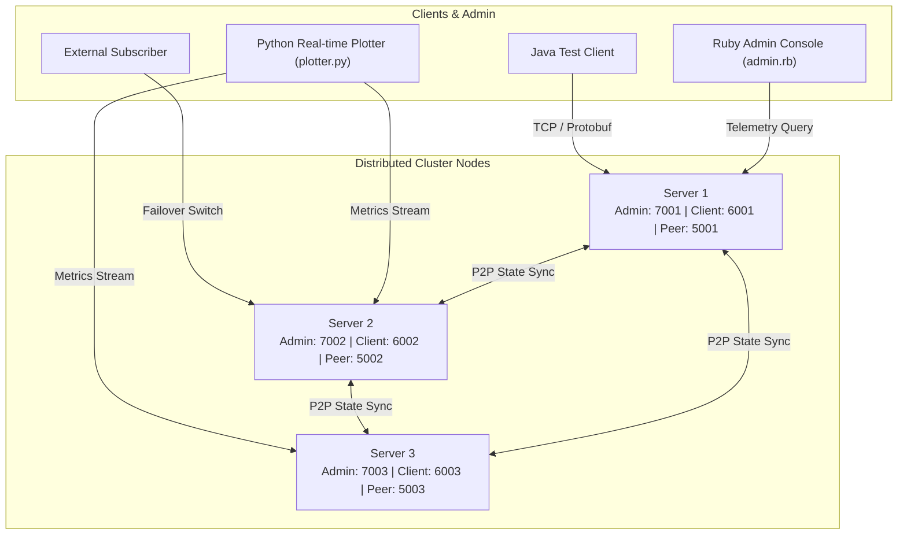

# Distributed Fault-Tolerant Subscriber Service (DFS-Mesh)

[](https://openjdk.org/)
[](https://protobuf.dev/)
[](https://maven.apache.org/)
[](#license)

A high-performance, fault-tolerant distributed subscription and telemetry mesh built in Java. The system implements leaderless peer-to-peer data replication, automated client failover, binary serialization via Google Protocol Buffers, and real-time cluster telemetry monitoring across Python and Ruby admin clients.

---

## Architecture Overview

The system operates as a distributed cluster of nodes that coordinate subscriber states, monitor node health, and replicate incoming traffic in real-time.



---

## Key Features

- **P2P State Synchronization & Replication:** Nodes synchronize subscriber state across the cluster using delimited Protocol Buffer messages (`SYNC` events), preventing data loss during node outages.
- **Dynamic Client Failover:** Clients maintain awareness of active cluster topologies and transparently migrate to adjacent healthy nodes upon socket disconnection.
- **Google Protocol Buffers Serialization:** Compact, binary-efficient network payloads for high-throughput messaging (`Subscriber`, `Configuration`, `Capacity`, `Message`).
- **Thread-Safe Concurrency Model:** Utilizes `ConcurrentHashMap`, explicit `ReentrantLock` boundaries, atomic counters, and `CompletableFuture` asynchronous listener loops to guarantee linearizability and deadlock prevention under concurrent load.
- **Multi-Language Telemetry Ecosystem:**
  - **Java Core:** High-throughput socket engine and cluster replication.
  - **Ruby Admin Panel (`admin.rb`):** Dynamic cluster configuration and remote capacity diagnostics.
  - **Python Live Monitor (`plotter.py`):** Real-time animated load distribution graph and CLI metrics reporting.

---

## Protobuf Definitions

The network protocol is strictly typed via Google Protocol Buffers:

| Schema | Purpose | Key Fields |
| :--- | :--- | :--- |
| [`Subscriber.proto`](protobufs/Subscriber.proto) | Subscriber entity and lifecycle | `id`, `name_surname`, `status` (`ONLINE`/`OFFLINE`), `last_accessed` |
| [`Configuration.proto`](protobufs/Configuration.proto) | Cluster topology & fault tolerance degree | `server_id`, `fault_tolerance`, `peer_servers` |
| [`Capacity.proto`](protobufs/Capacity.proto) | Real-time node capacity reports | `server_id`, `server_status`, `timestamp` |
| [`Message.proto`](protobufs/Message.proto) | Inter-node replication envelope | `type` (`SYNC`, `HEARTBEAT`), `payload`, `timestamp` |

---

## Directory Structure

```text
├── protobufs/              # Protocol Buffer schema definitions
│   ├── Capacity.proto
│   ├── Configuration.proto
│   ├── Message.proto
│   └── Subscriber.proto
├── src/main/java/
│   ├── dist_servers/       # Distributed server engine
│   │   ├── DistributedServer.java  # Core generic server node implementation
│   │   ├── Server1.java / Server2.java / Server3.java # Configured node instances
│   │   ├── AdminHandler.java       # Admin telemetry socket handler
│   │   ├── ClientHandler.java      # Client subscription socket handler
│   │   ├── ServerInterface.java    # Core server contract
│   │   └── FaultToleranceTest.java # Cluster failover automation suite
│   └── Clients/            # Client implementations
│       ├── Client.java             # Failover-capable client socket
│       └── TestClient.java         # Load and subscription simulation
├── panel/                  # Ruby Admin Control Interface
│   ├── admin.rb            # Admin socket client
│   └── lib/                # Compiled Ruby Protobuf bindings
├── plotting/               # Python Real-time Telemetry Monitor
│   └── plotter.py          # Interactive matplotlib & CLI metrics plotter
├── pom.xml                 # Maven build & Protobuf compilation config
└── README.md
```

---

## Getting Started

### Prerequisites
- **Java Development Kit (JDK 11+)**
- **Apache Maven 3.8+**
- *(Optional)* Python 3.8+ with `matplotlib` for live monitoring
- *(Optional)* Ruby 3.x for Admin CLI

### Build the Project
Compile the Protocol Buffers and build the executable JAR:
```bash
mvn clean compile
```

To package with dependencies:
```bash
mvn clean package
```

---

## Running the Cluster

### 1. Launch Server Nodes
You can start nodes individually in separate terminals:
```bash
# Start Server 1 (Admin: 7001, Client: 6001, Peer: 5001)
java -cp target/classes:$(mvn dependency:build-classpath | grep -v '\[INFO\]') dist_servers.Server1

# Start Server 2 (Admin: 7002, Client: 6002, Peer: 5002)
java -cp target/classes:$(mvn dependency:build-classpath | grep -v '\[INFO\]') dist_servers.Server2

# Start Server 3 (Admin: 7003, Client: 6003, Peer: 5003)
java -cp target/classes:$(mvn dependency:build-classpath | grep -v '\[INFO\]') dist_servers.Server3
```

### 2. Run Automated Fault-Tolerance Test
Simulates cluster startup, configuration injection, subscriber registration, and node shutdown failover:
```bash
java -cp target/classes:$(mvn dependency:build-classpath | grep -v '\[INFO\]') dist_servers.FaultToleranceTest
```

### 3. Launch Real-time Telemetry Monitor
Run the Python live monitoring dashboard:
```bash
# GUI Live Animated Chart
python plotting/plotter.py

# Headless / Terminal Monitor Mode
python plotting/plotter.py --cli
```

---

## License

This project is open-source and available under the [MIT License](LICENSE).
