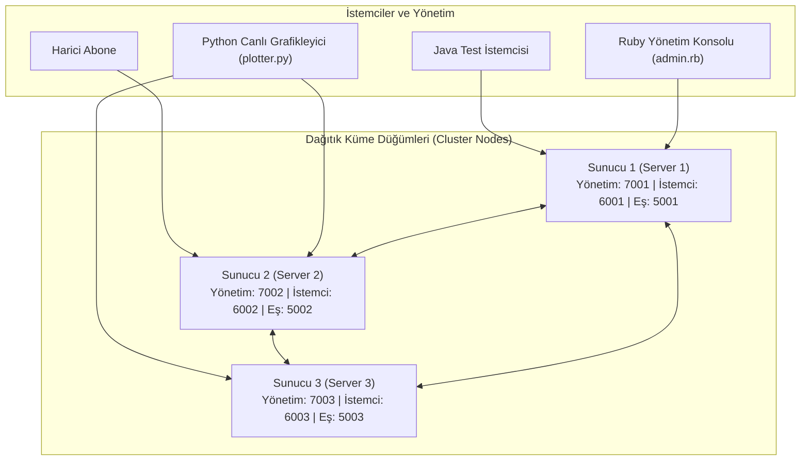

# Dağıtık ve Hata Toleranslı Abonelik Servisi (DFS-Mesh)

[](https://openjdk.org/)
[](https://protobuf.dev/)
[](https://maven.apache.org/)

Java ile geliştirilmiş, yüksek performanslı ve hata toleranslı (fault-tolerant) bir dağıtık abonelik ve telemetri servisidir. Sistem; lidersiz eşler arası (Peer-to-Peer) veri replikasyonu, otomatik istemci yük devretmesi (client failover), Google Protocol Buffers ile ikili serileştirme ve Python/Ruby tabanlı yönetim istemcileri ile gerçek zamanlı küme izleme mekanizmalarını içerir.

---

## Mimari Genel Bakış

Sistem, abone durumlarını senkronize eden, düğüm (node) sağlığını izleyen ve gelen trafiği gerçek zamanlı olarak çoğaltan (replicate eden) dağıtık bir düğüm kümesi olarak çalışır:



---

## Temel Özellikler

- **P2P Durum Senkronizasyonu ve Replikasyon:** Düğümler, abone durumunu küme genelinde Protocol Buffer mesajları (`SYNC` olayları) kullanarak eşitler; böylece bir düğüm devre dışı kalsa bile veri kaybı yaşanmaz.
- **Dinamik İstemci Yük Devretme (Failover):** İstemciler küme topolojisinden haberdardır. Bir sunucu çöktüğünde veya bağlantı koptuğunda, istemci bağlantıyı otomatik ve şeffaf olarak sağlıklı bir diğer düğüme aktarır.
- **Google Protocol Buffers ile İkili Serileştirme:** Ağ üzerinde yüksek verim ve düşük gecikme sağlayan, kesin tipli ikili mesajlaşma formatı (`Subscriber`, `Configuration`, `Capacity`, `Message`).
- **İş Parçacığı Güvenli (Thread-Safe) Eşzamanlılık:** Eşzamanlı yük altında kilitlenmeleri (deadlock) önlemek ve veri tutarlılığını sağlamak için `ConcurrentHashMap`, açık `ReentrantLock` sınırları, atomik sayaçlar (`AtomicInteger`) ve asenkron `CompletableFuture` dinleyici döngüleri kullanılır.
- **Çok Dilli (Multi-Language) Telemetri Ekosistemi:**
  - **Java Çekirdeği:** Yüksek verimli soket altyapısı ve küme replikasyonu.
  - **Ruby Yönetim Paneli (`admin.rb`):** Dinamik küme yapılandırması ve uzaktan kapasite/sağlık teşhisi.
  - **Python Canlı İzleme (`plotter.py`):** Gerçek zamanlı grafik arayüzü (`matplotlib`) ve terminal tabanlı metrik raporlama.

---

## Protobuf Şemaları

Ağ protokolü Google Protocol Buffers ile katı bir şekilde tiplendirilmiştir:

| Şema Dosyası | Amacı | Önemli Alanlar |
| :--- | :--- | :--- |
| [`Subscriber.proto`](protobufs/Subscriber.proto) | Abone varlığı ve yaşam döngüsü | `id`, `name_surname`, `status` (`ONLINE`/`OFFLINE`), `last_accessed` |
| [`Configuration.proto`](protobufs/Configuration.proto) | Küme topolojisi ve hata toleransı seviyesi | `server_id`, `fault_tolerance`, `peer_servers` |
| [`Capacity.proto`](protobufs/Capacity.proto) | Düğümlerin gerçek zamanlı kapasite ve yük raporu | `server_id`, `server_status`, `timestamp` |
| [`Message.proto`](protobufs/Message.proto) | Düğümler arası replikasyon ve eşitleme zarfı | `type` (`SYNC`, `HEARTBEAT`), `payload`, `timestamp` |

---

## Proje Dizin Yapısı

```text
├── protobufs/              # Protocol Buffer şema tanımları
│   ├── Capacity.proto
│   ├── Configuration.proto
│   ├── Message.proto
│   └── Subscriber.proto
├── src/main/java/
│   ├── dist_servers/       # Dağıtık sunucu motoru
│   │   ├── DistributedServer.java  # Temel jenerik sunucu düğüm uygulaması
│   │   ├── Server1.java / Server2.java / Server3.java # Yapılandırılmış düğüm örnekleri
│   │   ├── AdminHandler.java       # Yönetim telemetri soket işleyicisi
│   │   ├── ClientHandler.java      # İstemci abonelik soket işleyicisi
│   │   ├── ServerInterface.java    # Sunucu çekirdek arayüzü
│   │   └── FaultToleranceTest.java # Küme hata toleransı test otomasyonu
│   └── Clients/            # İstemci uygulamaları
│       ├── Client.java             # Failover yetenekli istemci soketi
│       └── TestClient.java         # Yük ve abonelik simülasyonu
├── panel/                  # Ruby Yönetim Kontrol Arayüzü
│   ├── admin.rb            # Yönetici soket istemcisi
│   └── lib/                # Derlenmiş Ruby Protobuf bağlayıcıları
├── plotting/               # Python Gerçek Zamanlı Telemetri Monitörü
│   └── plotter.py          # İnteraktif matplotlib ve CLI metrik grafikleyici
├── pom.xml                 # Maven derleme ve Protobuf eklenti konfigürasyonu
└── README.md
```

---

## Kurulum ve Başlangıç

### Gereksinimler
- **Java Development Kit (JDK 11 veya üzeri)**
- **Apache Maven 3.8 veya üzeri**
- *(İsteğe bağlı)* Canlı grafik izleme için Python 3.8+ ve `matplotlib`
- *(İsteğe bağlı)* Yönetim CLI için Ruby 3.x

### Projeyi Derleme
Protocol Buffer dosyalarını derlemek ve projeyi paketlemek için:
```bash
mvn clean compile
```

Bağımlılıkları içeren tek bir JAR (fat-jar) oluşturmak için:
```bash
mvn clean package
```

---

## Kümeyi Çalıştırma

### 1. Sunucu Düğümlerini Başlatma
Düğümleri ayrı terminallerde bağımsız olarak başlatabilirsiniz:
```bash
# Sunucu 1'i başlat (Yönetim: 7001, İstemci: 6001, Eş: 5001)
java -cp target/classes:$(mvn dependency:build-classpath | grep -v '\[INFO\]') dist_servers.Server1

# Sunucu 2'yi başlat (Yönetim: 7002, İstemci: 6002, Eş: 5002)
java -cp target/classes:$(mvn dependency:build-classpath | grep -v '\[INFO\]') dist_servers.Server2

# Sunucu 3'ü başlat (Yönetim: 7003, İstemci: 6003, Eş: 5003)
java -cp target/classes:$(mvn dependency:build-classpath | grep -v '\[INFO\]') dist_servers.Server3
```

### 2. Otomatik Hata Toleransı Testini Çalıştırma
Sunucuların ayağa kalkmasını, konfigürasyon dağıtımını, abone kaydını ve sunucu çökmesi durumunda failover senaryolarını test eder:
```bash
java -cp target/classes:$(mvn dependency:build-classpath | grep -v '\[INFO\]') dist_servers.FaultToleranceTest
```

### 3. Gerçek Zamanlı Telemetri Monitörünü Çalıştırma
Python canlı izleme panelini başlatmak için:
```bash
# Grafik Arayüzlü Canlı Monitör
python plotting/plotter.py

# Terminal / Konsol Tabanlı Metrik Monitörü
python plotting/plotter.py --cli
```
